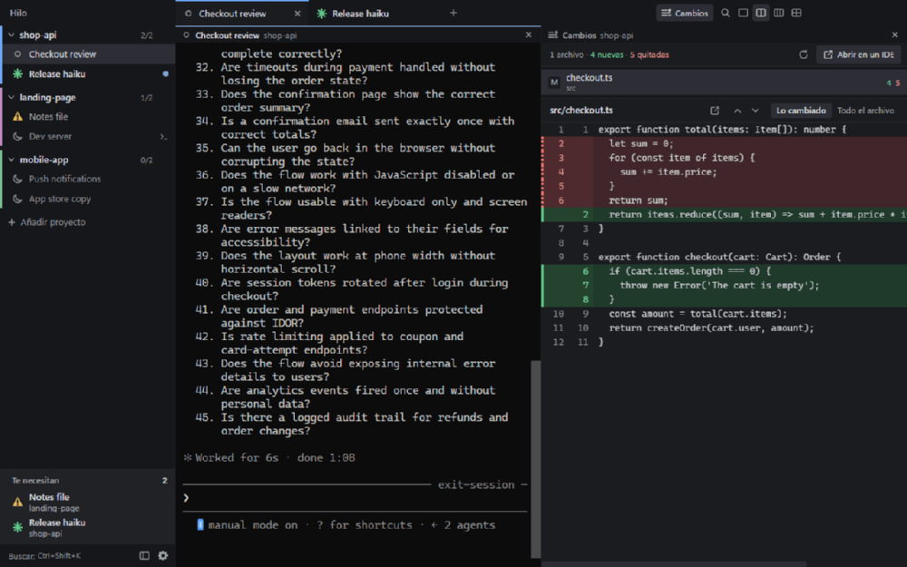

# Hilo

**Un gestor de terminales para Claude Code en Windows.** Abre muchas sesiones lado a lado, mira de un vistazo cuáles están trabajando, cuáles terminaron y cuáles te esperan, y recupéralas con su conversación después de cerrar la app o apagar el PC.

[English](README.md)



> Hilo es un proyecto independiente, no es de Anthropic ni está afiliado a Anthropic. Usa el Claude Code que ya tienes instalado.

## Para qué sirve

Con más de un par de sesiones de Claude Code, las pestañas ya no alcanzan: no sabes cuál terminó ni cuál lleva diez minutos esperando un permiso. Hilo las junta en una ventana y te dice dónde te necesitan.

## Qué hace

- **Estado a la vista.** Cada sesión muestra si está trabajando, si terminó y no la has visto, si te espera o si murió. El bloque "Te necesitan" junta lo que requiere atención.
- **Sesiones que sobreviven.** Cierra Hilo o apaga el PC, y tus sesiones vuelven con su conversación, con `claude --resume`.
- **Sesiones dormidas.** Dormir una sesión cierra su proceso y libera su memoria. Vuelve con un clic.
- **Terminales de verdad.** xterm.js sobre ConPTY, así que Claude Code funciona como en tu terminal de siempre. También hay sesiones de PowerShell.
- **Vistas divididas.** Hasta cuatro paneles, en vertical u horizontal. Arrastra una sesión al borde de un panel para sumarla ahí.
- **Panel Cambios.** Muestra qué archivos difieren del último commit, con las líneas nuevas en verde y las quitadas en rojo. Es de solo lectura.
- **Abrir en tu IDE.** Un clic en un número de línea abre ese archivo ahí. Hilo busca VS Code, Cursor, los IDE de JetBrains, NetBeans, Visual Studio, Eclipse, Sublime Text y Notepad++, y también puedes elegir un `.exe`.
- **Copiar y pegar con cuidado.** Ctrl+C copia si hay selección e interrumpe si no la hay, pegar varias líneas no ejecuta antes de tiempo, y Alt+V pega imágenes.
- **Liviano.** Unos 133 MB entre la app y sus consolas con 9 sesiones abiertas, sin contar a Claude.

El [manual](docs/MANUAL.md) explica cada función y cada atajo.

## Instalar

Necesitas Windows de 64 bits y [Claude Code](https://code.claude.com/docs) con tu cuenta iniciada. Si falta Claude Code o Git, Hilo explica cómo instalarlos la primera vez que abre.

1. Baja `Hilo-Setup-x.y.z.exe` desde [Releases](../../releases/latest).
2. Ábrelo y acepta la licencia. No pide permisos de administrador.

Las actualizaciones se ofrecen dentro de la app, en **Ajustes > Actualizaciones**. Nada se baja ni se instala hasta que lo aceptes.

### "Windows protegió su PC"

Hilo es un proyecto personal y no tiene certificado de firma de código, porque esos certificados se pagan. Por eso Windows SmartScreen puede avisar: pulsa **Más información** y luego **Ejecutar de todas formas**. Tu antivirus también podría preguntar.

No hay ninguna intención maliciosa detrás de Hilo, pero no tienes por qué creerme sin más. El aviso significa que Windows no conoce al autor, no que haya encontrado algo malo, y tampoco prueba que el archivo sea seguro. Aquí puedes leer todo el código, armar tu propio instalador o pedirle a tu Claude Code que lo revise:

```
git clone https://github.com/ivanmaxor/Hilo-App.git
cd Hilo-App
claude "Audita este repositorio en busca de problemas de seguridad y privacidad. Revisa qué envía por la red, qué archivos lee y escribe fuera de su carpeta, y si toca credenciales. Dime lo que encuentres, con archivo y línea."
```

Los instaladores publicados se arman en el PC del autor. Leer este código te dice qué hace el código, pero no prueba que un instalador salga de él. Si eso te importa, arma el tuyo.

## Privacidad

- **Hilo solo se conecta a GitHub**, para buscar y bajar versiones nuevas: una vez al abrir, si no lo apagas, y cuando pulsas el botón.
- No tiene telemetría ni analítica, ni fuentes o scripts remotos. La interfaz misma no tiene acceso a la red.
- Hilo nunca lee tu token ni tus credenciales de Claude, y no cambia tu configuración global de Claude Code. Sus hooks de estado solo llegan a las sesiones que abre, con `claude --settings`.
- Claude Code se conecta a Anthropic por su cuenta dentro de cada sesión, como en cualquier terminal.

Sin firma, una actualización solo se comprueba contra el SHA-512 publicado en GitHub, por HTTPS. Eso detecta una descarga dañada, no que alguien tome el control de esta cuenta de GitHub.

## Armarlo desde el código

Necesitas Node.js 22 o más nuevo y Git.

```
npm ci
npm start          # compila y abre
npm test           # pruebas unitarias
npm run e2e        # pruebas sobre la app real
npm run dist       # instalador en release/
```

Empieza por [CONTRIBUTING.md](CONTRIBUTING.md). Las decisiones de diseño están en [docs/DECISIONES.md](docs/DECISIONES.md) y las auditorías en [docs/AUDITORIA.md](docs/AUDITORIA.md).

## Licencia

[MIT](LICENSE.txt). Hilo incluye software de terceros con otras licencias, como Electron, y FFmpeg con LGPL: revisa [THIRD_PARTY_NOTICES.txt](assets/THIRD_PARTY_NOTICES.txt).
