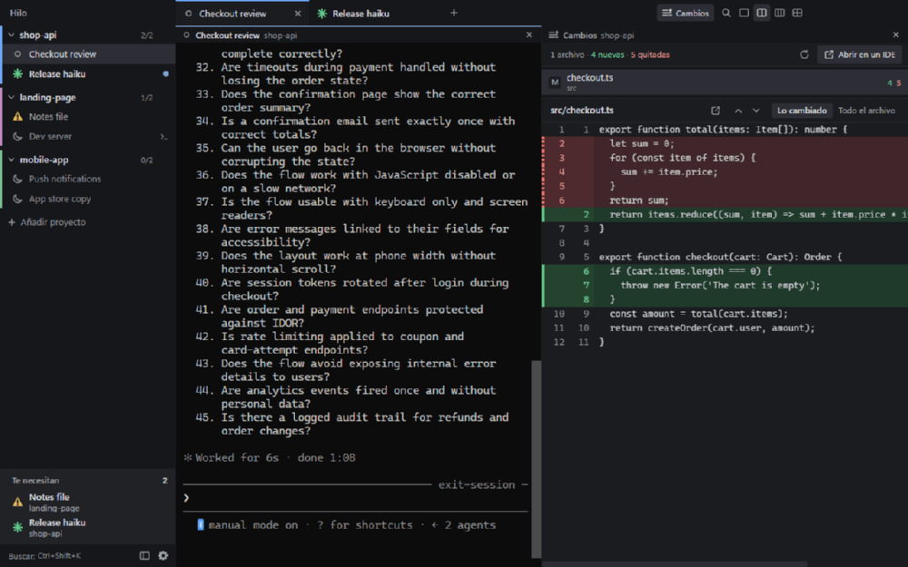

# Hilo

**A Windows terminal manager for Claude Code.** Run many sessions side by side, see at a glance which ones are working, finished or waiting for you, and get them back with their conversation after you close the app or restart your PC.

[](../../releases/latest)
[](LICENSE.txt)


[Español](README.es.md)



> The interface is in Spanish for now. Hilo is an independent project, not made by or affiliated with Anthropic. It runs the Claude Code you already have installed.

## Why

With more than a couple of Claude Code sessions, tabs stop being enough: you can't tell which one finished or which one has been waiting on a permission prompt for ten minutes. Hilo keeps them all in one window and tells you where you're needed.

## What it does

- **Status at a glance.** Every session shows whether it's working, finished and unseen, waiting for you, or dead. A "needs you" list gathers what requires attention.
- **Sessions that survive.** Close Hilo or shut down your PC, and your sessions come back with their conversation, using `claude --resume`.
- **Sleeping sessions.** Put a session to sleep to close its process and free its memory. One click brings it back.
- **Real terminals.** xterm.js on top of ConPTY, so Claude Code behaves as it does in your usual terminal. PowerShell sessions work too.
- **Splits.** Up to four panes, vertical or horizontal. Drag a session to a pane's edge to add it there.
- **Changes panel.** See which files differ from the last commit, with new lines in green and removed lines in red. It's read-only.
- **Open in your IDE.** Click a line number to open that file there. Hilo looks for VS Code, Cursor, the JetBrains IDEs, NetBeans, Visual Studio, Eclipse, Sublime Text and Notepad++, or you can pick an `.exe`.
- **Careful with copy and paste.** Ctrl+C copies with a selection and interrupts without one, multi-line pastes don't run early, and Alt+V pastes images.
- **Light on memory.** About 133 MB for the app and its consoles with 9 sessions open, not counting Claude itself.

The [manual](docs/MANUAL.md), in Spanish, covers every feature and keyboard shortcut.

## Install

You need 64-bit Windows and [Claude Code](https://code.claude.com/docs) signed in to your account. If Claude Code or Git is missing, Hilo explains how to install it the first time it opens.

1. Download `Hilo-Setup-x.y.z.exe` from [Releases](../../releases/latest).
2. Run it and accept the license. It doesn't need administrator rights.

Updates are offered inside the app, under **Ajustes > Actualizaciones**. Nothing is downloaded or installed until you accept.

### "Windows protected your PC"

Hilo is a personal project and has no code signing certificate, because those cost money. Windows SmartScreen may warn you for that reason: choose **More info**, then **Run anyway**. Your antivirus may ask as well.

There's no malicious intent behind Hilo, but don't just take my word for it. The warning means Windows doesn't know the author, not that it found something bad, and it doesn't prove the file is safe either. You can read everything here, build the installer yourself, or ask your own Claude Code to review it:

```
git clone https://github.com/ivanmaxor/Hilo-App.git
cd Hilo-App
claude "Audit this repository for security and privacy problems. Check what it sends over the network, which files it reads and writes outside its own folder, and whether it touches credentials. Report what you find, with file and line."
```

The released installers are built on the author's PC, so reading this code tells you what the code does, but it doesn't prove that an installer came from it. If that matters to you, build your own.

## Privacy

- **The only connection Hilo makes is to GitHub**, to look for and download new versions: once when it opens, unless you turn that off, and when you press the button.
- There's no telemetry or analytics, and no remote fonts or scripts. The interface itself has no network access.
- Hilo never reads your Claude token or credentials, and doesn't change your global Claude Code configuration. Its status hooks only reach the sessions it opens, through `claude --settings`.
- Claude Code connects to Anthropic on its own inside each session, as it would in any terminal.

Without a signature, an update is only checked against the SHA-512 published on GitHub, over HTTPS. That catches a damaged download, not someone taking over this GitHub account.

## Build from source

You need Node.js 22 or newer and Git.

```
npm ci
npm start          # build and open
npm test           # unit tests
npm run e2e        # end-to-end tests on the real app
npm run dist       # installer in release/
```

Start with [CONTRIBUTING.md](CONTRIBUTING.md). Design decisions are in [docs/DECISIONES.md](docs/DECISIONES.md) and the audits in [docs/AUDITORIA.md](docs/AUDITORIA.md), both in Spanish.

## License

[MIT](LICENSE.txt). Hilo includes third-party software under other licenses, such as Electron, and FFmpeg under the LGPL: see [THIRD_PARTY_NOTICES.txt](assets/THIRD_PARTY_NOTICES.txt).
